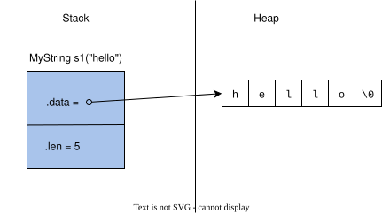

# MyString class

In this chapter, we will create our own string implementation, `MyString` class. The C++ Standard Library already provides a very powerful and fast `std::string` class. Why then are we reinventing the wheel?

Writing our own string class will give us an opportunity to learn and practice the anatomy of C++ classes in a familiar setting where we already know how the class is supposed to behave.

Another reason to study our own string class is that it will give us a good mental model on how `std::string` class works under the hood. Even though `std::string` is highly optimized and does a lot of things that our naive implementation will not do, the way MyString class manages the underlying heap-allocated string still provides a good mental model for us to understand how real string works and how any class should properly manage its acquired resources.

## Source code organization

First, let’s make sure we understand how MyString class source code is organized. We will study the following source files:

- `Makefile`
- `mystring.h`
- `mystring.cpp`
- `test1.cpp`, `test2.cpp`, `test3.cpp`, `test4.cpp`, `test5.cpp`

## `mystring.h` and `mystring.cpp`

Unlike in Java & Python, we do not normally write member function definitions inside the class definition. We usually write member function declarations inside the class definition, and put them in a header file. Here is an excerpt from mystring.h:
```c++
class MyString {
public:

    // default constructor
    MyString();

    // constructor
    MyString(const char* p);

    // destructor
    ~MyString();

    ...

    // returns the length of the string
    int length() const { return len; }

    ...

private:

    char* data;

    int len;
};
```
There are times where we write member function definitions in the class definition, like the `length()` member function shown above. We’ll circle back to that later.

## Basic 4 of MyString
### Constructor

MyString has two constructors: a default constructor that takes no arguments, and a constructor that takes a `char*`. Let’s start by looking at the latter.

We can declare a MyString object on the stack like this:
```cpp
MyString s1("hello");
```

`"hello"` is a string literal, which is an array of 6 characters (including the null-terminator). The string literal gets converted into a `char*`, a pointer to the first character of the string, when we use it to initialize s1. So where in memory are those characters?

Recall our process memory address space diagram:
```
         +--------------------------------------------------+
         | operating system code & data                     |
    512G +--------------------------------------------------+
         | stack        (for automatic variables)           |
         +--------------------------------------------------+
         |        |                                         |
         |        |                                         |
         |        v     (stack grows down)                  |
         |                                                  |
         |                                                  |
         |                                                  |
         |        ^     (heap grows up)                     |
         |        |                                         |
         |        |                                         |
         +--------------------------------------------------+
         | heap         (for memory allocated by malloc())  |
         +--------------------------------------------------+
         | data section (for static variables)              |
         +--------------------------------------------------+
         | code section (for the program code)              |
       0 +--------------------------------------------------+
```

String literals are part of the program code. To be more exact, the characters in a string literal are actually stored in a section called rodata (read-only data), right in-between code and data:
```
         | ...                                              |
         +--------------------------------------------------+
         | data section                                     |
         +--------------------------------------------------+
         | rodata section                                   |
         |                                                  |
         |  +------------------------+                      |
         |  | h | e | l | l | o | \0 |                      |
         |  +------------------------+                      |
         +--------------------------------------------------+
         | code section                                     |
       0 +--------------------------------------------------+
```

With that in mind, look at MyString’s private fields:
```cpp
class MyString {
public:
    ...
    // constructor
    MyString(const char* p);
    ...

private:
    char* data;
    int len;
};
```

MyString records the length of the string for convenience. In our example, `len` will be 5. `data` is supposed to point to the characters that make up the MyString. Is it enough to just store the pointer provided in the constructor? In this case, can we just refer to the characters in the `rodata` section?

As it name suggests, rodata memory is read-only. That means we can’t mutate a string literal. We want to be able to modify the characters in a MyString, so pointing to the string literal characters won’t do.

The MyString constructor will have to create a copy of the string on the heap and point to that instead. MyString has to own its underlying string. Taking the example of declaring `MyString s1("hello")` on the stack, its memory layout will look like this:


